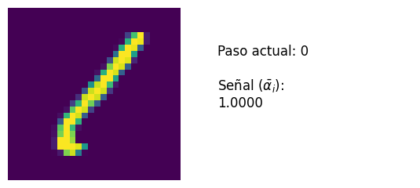
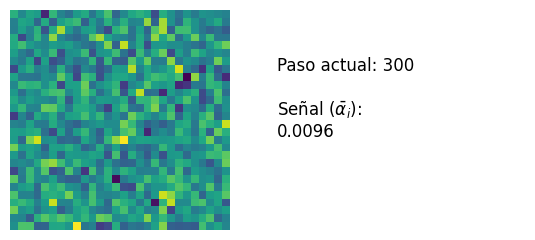
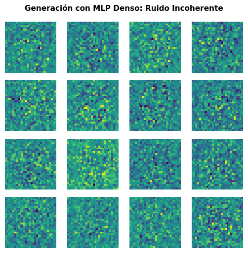
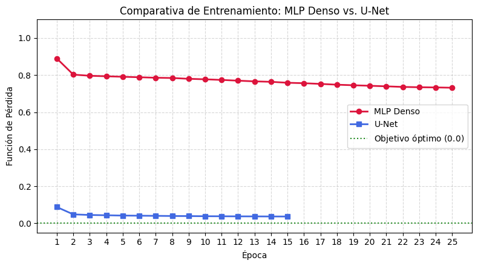
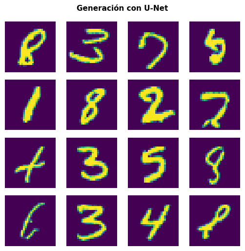
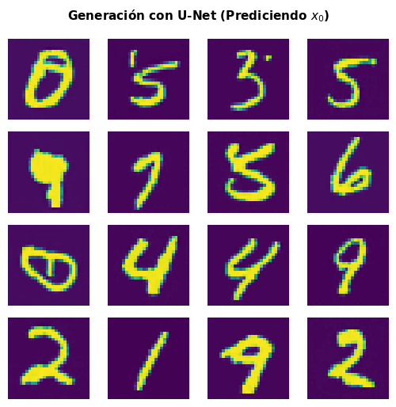
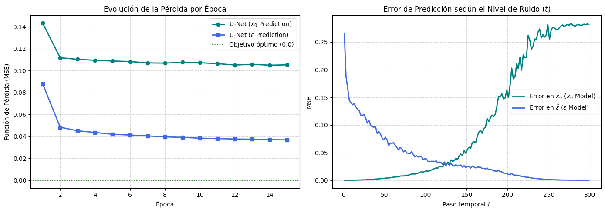

# DDPM-MNIST

Implementación **desde cero en PyTorch** de un *Denoising Diffusion Probabilistic Model* (DDPM) para generar dígitos manuscritos del dataset **MNIST**.

El proyecto está pensado como material didáctico: en un único notebook se parte de la teoría (proceso *forward* y *reverse*), se comparan **tres parametrizaciones** de lo que debe predecir la red (media, ruido y $x_0$) y **dos arquitecturas** (MLP y U-Net), mostrando de forma práctica por qué unas funcionan y otras no.

<p align="center">
  
  
</p>
<p align="center"><em>Izquierda: forward process (el dígito se difumina hasta ser ruido). Derecha: reverse process con la media analítica conocida $x_0$.</em></p>

---

## Contenido

- [Qué se hace en el notebook](#qué-se-hace-en-el-notebook)
- [Resultados](#resultados)
- [Estructura del repositorio](#estructura-del-repositorio)
- [Instalación y uso](#instalación-y-uso)
- [Hiperparámetros](#hiperparámetros)
- [Detalles de implementación](#detalles-de-implementación)
- [Referencias](#referencias)

---

## Qué se hace en el notebook

El notebook `ModelosDifusión.ipynb` sigue este recorrido:

1. **Preparación de datos.** MNIST escalado al rango $[-1, 1]$ para que, al añadir ruido gaussiano, la distribución final converja a $\mathcal{N}(0, \mathbf{I})$.
2. **Forward process.** Schedule de ruido con $L = 300$ pasos y $\beta$ creciente de $0$ a $0.3$, con $\alpha_i = \sqrt{1-\beta_i^2}$ y $\bar{\alpha}_i = \prod_{k\le i}\alpha_k$. Se usa la fórmula cerrada
   $$x_i = \bar{\alpha}_i x_0 + \sqrt{1-\bar{\alpha}_i^2}\,\epsilon,\quad \epsilon\sim\mathcal{N}(0,\mathbf{I})$$
   para corromper una imagen a cualquier paso sin simular la cadena completa.
3. **Reverse process.** Cálculo de la media y varianza analíticas de $p(x_{i-1}\mid x_i, x_0)$ y comprobación visual de que, conociendo $x_0$, se recupera el dígito.
4. **Time embedding sinusoidal** para informar a la red del paso temporal $i$.
5. **Tres formas de entrenar el modelo generativo:**

   | # | Parametrización | Salida de la red | Pérdida |
   |---|-----------------|------------------|---------|
   | 1 | **Mean prediction** | $\mu_\phi(x_i, i)$ | MSE ponderado por $1/(2\sigma^2(i))$ |
   | 2 | **Noise prediction** | $\epsilon_\phi(x_i, i)$ | $\mathcal{L}_{\text{simple}}$ (MSE sin ponderar) |
   | 3 | **$x_0$ prediction** | $\hat{x}_0(x_i, i)$ | MSE directo contra $x_0$ |

6. **Dos arquitecturas:** un **MLP denso** (que colapsa) y una **U-Net** con bloques residuales y condicionamiento temporal (que genera dígitos coherentes).
7. **Muestreo** desde ruido puro y análisis del error por nivel de ruido.

---

## Resultados

### Mean prediction: inestabilidad numérica

Con la pérdida original ponderada, el factor $1/\sigma^2(i)$ diverge cuando $i\to 0$ (donde $\sigma_0 = 0$), lo que puede producir `Inf`/`NaN`. Eliminar la ponderación tampoco es una solución, porque desbalancea el aprendizaje: dominan los pasos con poco ruido y se descuidan los de mucho ruido, que son los que estructuran la forma global del dígito. Esto motiva el cambio a la predicción de ruido.

### MLP denso: colapso

Con predicción de ruido, el MLP (aplanado + capas `Linear`) pierde la noción espacial de la imagen. La pérdida se queda lejos del óptimo y al generar desde ruido puro **no produce dígitos**:

<p align="center">
  
</p>

### U-Net: generación coherente

Al sustituir el MLP por una U-Net convolucional, el modelo aprende con eficacia a predecir el ruido y genera dígitos reconocibles.

<p align="center">
  
</p>

| Predicción de $\epsilon$ (U-Net) | Predicción de $x_0$ (U-Net) |
|:---:|:---:|
|  |  |

Ambas parametrizaciones generan dígitos válidos con la misma arquitectura. En el notebook se comparan además sus curvas de entrenamiento y el error de predicción en función del paso temporal:

<p align="center">
  
</p>


---

## Estructura del repositorio

```
DDPM-MNIST/
├── ModelosDifusión.ipynb   # Notebook principal (teoría + código + experimentos)
├── assets/                 # Figuras y GIFs usados en este README
├── README.md
```


---

## Instalación y uso

### Opción A: Google Colab (recomendada)

El notebook está pensado para Colab: monta Google Drive para guardar y cargar pesos entrenados en `MyDrive/modelos_difusion`.

1. Sube el notebook a Colab (o ábrelo desde GitHub).
2. Selecciona un entorno con **GPU** (*Entorno de ejecución → Cambiar tipo de entorno*).
3. Ejecuta las celdas en orden. MNIST se descarga automáticamente.

### Opción B: Ejecución local

```bash
git clone https://github.com/arturo-olvrs/DDPM-MNIST.git
cd DDPM-MNIST
pip install torch torchvision matplotlib pillow tqdm jupyter
jupyter notebook ModelosDifusión.ipynb
```

Para ejecutarlo en local hay que **adaptar las celdas de Google Drive**: eliminar `from google.colab import drive` / `drive.mount(...)` y definir `DRIVE_DIR` como una carpeta local, por ejemplo:

```python
DRIVE_DIR = "./checkpoints"
os.makedirs(DRIVE_DIR, exist_ok=True)
```

### Entrenar o cargar modelos

La función `train_or_load_model(...)` controla ambos modos mediante el parámetro `train`:

- `train=True`: entrena y guarda los pesos (`.pth`) y el historial de pérdida (`_loss.pt`).
- `train=False`: carga los pesos y el historial guardados. Falla con un error claro si los archivos no existen.

Por tanto, **la primera vez hay que ejecutar con `train=True`** en los modelos que se quieran usar (`model_eps_MLP.pth`, `model_eps_UNet.pth`, `model_x0_UNet.pth`).

---

## Hiperparámetros

| Parámetro | Valor |
|---|---|
| Pasos de difusión $L$ | 300 |
| Schedule $\beta$ | lineal, $0 \to 0.3$ |
| Tamaño de imagen | $1\times 28\times 28$, rango $[-1, 1]$ |
| Batch size | 16 |
| Optimizador | AdamW (`weight_decay=0`) |
| Scheduler | OneCycleLR (coseno, `pct_start=0.05`) |
| Gradient clipping | 1.0 |
| EMA de pesos | 0.999 |
| **MLP**: épocas / LR máx. | 25 / 1e-3 |
| **U-Net**: épocas / LR máx. | 15 / 2e-4 |

---

## Detalles de implementación

- **Time embedding.** Embedding sinusoidal (senos y cosenos a frecuencias decrecientes): 64 dimensiones para el MLP y 128 para la U-Net (proyectadas a 256 mediante un pequeño MLP).
- **MLP.** Imagen aplanada (784) concatenada con el embedding temporal (64) → `Linear(848→256)` → `SiLU` → `Linear(256→256)` → `SiLU` → `Linear(256→784)` → *reshape*.
- **U-Net.** Convolución de entrada, dos niveles de *downsampling* (`Conv2d` con *stride* 2), cuello de botella y dos niveles de *upsampling* con *skip connections*. Cada `ResBlock` usa `GroupNorm`, `SiLU`, dos convoluciones $3\times3$ e inyecta el embedding temporal. Canales base: 64.
- **Pérdida con Monte Carlo.** En lugar de sumar sobre los $L$ pasos, se muestrea un paso $i$ uniforme por imagen en cada iteración (estimador insesgado de la suma).
- **EMA.** El modelo guardado es el promedio móvil exponencial de los pesos.
- **Reproducibilidad.** Semilla fija (`SEED = 42`) y `cudnn.deterministic = True`.
- **Muestreo.** Se parte de $x_L\sim\mathcal{N}(0,\mathbf{I})$ y se itera de $i=L$ a $1$ calculando la media $\mu_\phi$ a partir de la salida de la red (directamente, o derivando $\epsilon$ desde $\hat{x}_0$) y añadiendo ruido $\sigma(i)z$.
